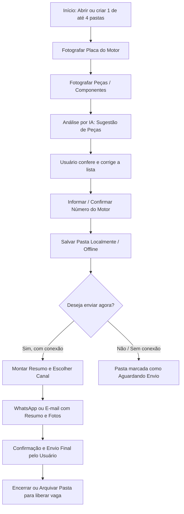

# PRD — Aplicativo de Registro, Identificação e Envio de Peças para Retífica de Motores

> [!NOTE]
> **Status:** Ideia registrada — não iniciar desenvolvimento neste momento  
> **Data do registro:** 21 de outubro de 2026  
> **Área:** Retífica de motores

---

## 1. Visão do Produto

Aplicativo funcional para registrar a entrada ou o envio de conjuntos e peças de motores em uma retífica. O usuário poderá fotografar a placa e os itens recebidos/enviados. A partir das fotos, o aplicativo deverá utilizar inteligência artificial para identificar quais peças estão presentes e registrar essa composição junto ao número do motor.

O produto deve ser simples, direto e focado exclusivamente em:
- Fotografar a placa e os componentes;
- Identificar o básico das peças;
- Registrar o número do motor;
- Enviar as informações coletadas por WhatsApp ou e-mail.

O aplicativo também deverá **funcionar offline**, mantendo os registros salvos no aparelho e permitindo continuar o trabalho mesmo sem internet.

---

## 2. Problema

Atualmente é necessário:
- Fotografar a placa do motor;
- Digitar manualmente os produtos ou peças que estão indo;
- Conferir se determinadas peças estão acompanhando o motor;
- Identificar se o cabeçote está montado ou desmontado;
- Associar todos os itens ao número do motor.

Esse processo pode gerar esquecimentos, erros de digitação e dificuldade para comprovar posteriormente quais peças foram recebidas ou enviadas.

---

## 3. Objetivo Principal

Permitir que o usuário fotografe a placa e os itens de um motor, receba uma identificação automática básica das peças visíveis, informe o número do motor e envie o resumo do registro por WhatsApp ou e-mail. O fluxo deve continuar funcionando sem conexão, com armazenamento local dos dados e sincronização ou compartilhamento assim que a conexão estiver disponível.

O MVP não precisa ter uma área complexa de histórico ou gestão interna. O resultado principal do aplicativo é gerar rapidamente uma mensagem ou e-mail organizado a partir das fotos e informações coletadas.

---

## 4. Escopo do MVP

O MVP deverá conter somente o fluxo essencial:

1. Abrir uma pasta de registro para uma placa;
2. Tirar foto da placa;
3. Tirar foto de uma ou mais peças;
4. Identificar as peças básicas pela foto, inclusive cabeçote, bloco e biela;
5. Informar ou confirmar o número do motor;
6. Revisar o resumo;
7. Salvar a pasta mesmo sem internet;
8. Enviar as informações por WhatsApp ou e-mail quando o canal estiver disponível.

### 4.1 Captura da placa
- Tirar uma foto da placa do motor;
- Armazenar a imagem junto ao registro;
- Opcionalmente, utilizar leitura automática dos dados visíveis na placa, caso essa função seja incluída na implementação;
- Permitir que o usuário refaça a foto se ela estiver ilegível.

### 4.2 Captura dos itens
Permitir tirar uma ou mais fotos dos produtos e peças que estão acompanhando o motor. As fotos poderão mostrar, individualmente ou em conjunto:
- Cabeçote;
- Virabrequim;
- Pistões;
- Bielas;
- Comando de válvulas;
- Tampa de válvula;
- Outros itens visualmente identificáveis relacionados ao conjunto do motor.

### 4.3 Identificação automática por foto
A inteligência artificial deverá analisar as fotos e sugerir quais peças estão presentes. O sistema deverá conseguir diferenciar, quando possível:
- Cabeçote com tampa de válvula montado;
- Cabeçote desmontado;
- Tampa de válvula separada;
- Somente cabeçote;
- Somente bloco;
- Somente biela;
- Virabrequim;
- Pistão ou conjunto de pistões;
- Biela ou conjunto de bielas;
- Comando de válvulas.

A identificação deverá ser apresentada ao usuário para conferência antes de salvar o registro. O usuário deverá poder corrigir, remover ou adicionar itens manualmente caso a análise da foto não esteja correta.

Quando houver somente um item principal visível, o resultado deverá deixar claro que o registro contém, por exemplo, *“somente cabeçote”*, *“somente bloco”* ou *“somente biela”*, sem presumir que as demais peças estão presentes.

Se a foto não permitir uma identificação segura, o aplicativo deverá marcar o item como *“não identificado”* ou *“precisa de confirmação”*, em vez de inventar uma peça.

### 4.4 Número do motor
Ao finalizar o registro, o aplicativo deverá exibir um campo para o usuário adicionar o número do motor. Esse campo deverá permitir:
- Digitação manual do número do motor;
- Revisão antes de salvar;
- Associação do número às fotos da placa e dos itens identificados.

### 4.5 Montagem do resumo
Depois da análise das fotos, o aplicativo deverá montar um resumo simples contendo:
- Número do motor;
- Peças identificadas;
- Situação do cabeçote, quando identificável;
- Observações ou correções feitas pelo usuário;
- Fotos da placa e das peças, quando forem anexadas ao envio.

O usuário deverá visualizar e revisar esse resumo antes de enviá-lo.

### 4.6 Envio por WhatsApp
- Abrir o WhatsApp com uma mensagem já preenchida;
- Deixar o usuário escolher o contato ou grupo e confirmar o envio no próprio WhatsApp;
- Quando possível, fotos também deverão ser compartilhadas junto com a mensagem;
- O aplicativo não deverá enviar mensagens automaticamente sem a confirmação do usuário.

### 4.7 Envio por e-mail
- Abrir o aplicativo de e-mail do celular, quando disponível;
- Preencher o assunto;
- Preencher o corpo do e-mail com o resumo;
- Anexar as fotos, quando suportado pelo aparelho;
- Permitir que o usuário revise destinatário, conteúdo e anexos antes do envio.

### 4.8 Funcionamento offline
O aplicativo deverá funcionar sem internet para as etapas de captura, organização e armazenamento dos registros.

No modo offline, o usuário deverá conseguir:
- Abrir uma nova pasta de registro;
- Fotografar a placa;
- Fotografar as peças;
- Informar o número do motor;
- Conferir e corrigir os itens identificados, quando a capacidade de análise estiver disponível localmente;
- Salvar e continuar editando a pasta;
- Fechar o aplicativo e retornar depois sem perder os dados.

O envio por WhatsApp ou e-mail dependerá da disponibilidade do respectivo aplicativo e de conexão. Enquanto estiver sem conexão, a pasta deverá ficar marcada como *“aguardando envio”*, sem perder as fotos ou informações. Ao voltar a ter internet, o usuário poderá abrir a pasta e compartilhar o resumo.

### 4.9 Pastas simultâneas
O aplicativo deverá permitir manter **até quatro pastas de placas abertas ao mesmo tempo** no MVP. Cada pasta deverá ser independente e conter suas próprias:
- Foto da placa;
- Fotos das peças;
- Identificações;
- Correções do usuário;
- Número do motor;
- Status de preenchimento;
- Status de envio.

O aplicativo deverá mostrar visualmente qual pasta está aberta e evitar que fotos ou peças sejam associadas à placa errada. O usuário poderá alternar entre as quatro pastas, pausar uma e continuar outra, inclusive offline.

Quando uma pasta for concluída e enviada, ela poderá ser encerrada ou arquivada para liberar espaço para uma nova pasta, sem apagar os dados antes de uma confirmação do usuário.

---

## 5. Fluxo Principal do Usuário

1. O usuário abre uma das quatro pastas disponíveis ou cria uma nova pasta.
2. O aplicativo solicita a foto da placa do motor.
3. O usuário tira e confirma a foto da placa.
4. O aplicativo solicita fotos dos itens que estão acompanhando o motor.
5. O usuário tira uma ou mais fotos das peças.
6. A inteligência artificial analisa as imagens, quando essa análise estiver disponível no aparelho ou quando houver conexão.
7. O aplicativo apresenta uma lista dos itens identificados, distinguindo cabeçote, bloco, biela e os demais itens previstos.
8. O usuário confere e corrige a lista, se necessário.
9. O usuário informa o número do motor.
10. O usuário salva a pasta. Se estiver offline, o aplicativo mantém tudo armazenado localmente.
11. O usuário pode alternar para outra pasta e continuar o trabalho.
12. O aplicativo monta um resumo com o número do motor, as peças e as fotos.
13. Quando houver conexão e o canal estiver disponível, o usuário escolhe “Enviar por WhatsApp” ou “Enviar por e-mail”.
14. O aplicativo abre o canal escolhido com a mensagem preparada.
15. O usuário revisa e confirma o envio no WhatsApp ou no aplicativo de e-mail.

---

## 6. Requisitos Funcionais

| ID | Nome | Descrição |
| :--- | :--- | :--- |
| **RF01** | Criar registro | O usuário deve conseguir iniciar um novo registro para um motor. |
| **RF02** | Fotografar placa | O sistema deve permitir capturar e armazenar uma foto da placa do motor. |
| **RF03** | Fotografar peças | O sistema deve permitir capturar uma ou mais fotos das peças associadas ao motor. |
| **RF04** | Analisar imagens | O sistema deve enviar as fotos dos itens para análise e retornar uma lista de peças identificadas. |
| **RF05** | Identificar estado do cabeçote | O sistema deve indicar, quando possível, se o cabeçote está montado com a tampa de válvula, desmontado ou acompanhado da tampa separadamente. |
| **RF06** | Editar identificação | O usuário deve conseguir confirmar, corrigir, remover ou adicionar itens à lista gerada pela inteligência artificial. |
| **RF07** | Informar número do motor | O sistema deve disponibilizar um campo para digitação do número do motor antes da conclusão do registro. |
| **RF08** | Salvar registro | O sistema deve salvar as fotos, o número do motor e a lista final de itens como um único registro. |
| **RF09** | Gerar resumo | O sistema deve gerar uma mensagem organizada com as informações coletadas, em linguagem simples e adequada para envio. |
| **RF10** | Compartilhar por WhatsApp | O sistema deve permitir abrir o WhatsApp com o resumo pré-preenchido e, quando possível, as fotos selecionadas para compartilhamento. |
| **RF11** | Compartilhar por e-mail | O sistema deve permitir abrir o aplicativo de e-mail com assunto, corpo do texto e fotos anexadas, quando suportado pelo dispositivo. |
| **RF12** | Confirmar antes de enviar | O sistema deve permitir ao usuário revisar o conteúdo antes de sair do aplicativo e concluir o envio no canal escolhido. |
| **RF13** | Funcionar offline | O sistema deve permitir capturar fotos, preencher dados e salvar pastas sem conexão com a internet. |
| **RF14** | Armazenar localmente | O sistema deve armazenar no aparelho as fotos, os dados e o andamento das pastas offline, preservando os dados após o fechamento ou reabertura do aplicativo. |
| **RF15** | Manter até quatro pastas abertas | O sistema deve permitir até quatro pastas de placas abertas simultaneamente, com dados independentes e possibilidade de alternância entre elas. |
| **RF16** | Identificar peças principais | O sistema deve tentar diferenciar pelo menos: somente cabeçote, somente bloco, somente biela, cabeçote com tampa de válvula montado, cabeçote desmontado, tampa de válvula separada, virabrequim, pistões e comando de válvulas. |
| **RF17** | Indicar pendência de análise ou envio | O sistema deve indicar quando uma pasta está aguardando análise, confirmação do usuário, conexão ou envio. |

---

## 7. Dados Mínimos de Cada Registro

Cada registro deverá conter:

- **Identificador interno** do registro;
- **Data e hora** do registro;
- **Foto da placa**;
- **Uma ou mais fotos das peças**;
- **Lista de peças identificadas pela IA**;
- **Lista final de peças** confirmada pelo usuário;
- **Estado do cabeçote**, quando identificável;
- **Número do motor**;
- **Status da análise**, caso a identificação automática falhe ou fique pendente;
- **Canal de compartilhamento escolhido**, quando houver;
- **Data e hora do compartilhamento**, quando disponível para o aplicativo;
- **Identificador da pasta** (Pasta 1, 2, 3 ou 4);
- **Status da pasta**: *aberta*, *em preenchimento*, *aguardando análise*, *pronta para envio*, *aguardando conexão*, *enviada* ou *arquivada*;
- **Data e hora da última alteração**;
- **Indicação de que os dados foram salvos localmente**.

---

## 8. Requisitos de Experiência do Usuário (UX)

- O fluxo deve ser rápido e adequado ao uso em ambiente de oficina;
- O aplicativo deve priorizar **botões grandes e poucas etapas**;
- O usuário não deve precisar conhecer termos técnicos de inteligência artificial;
- A lista identificada deve ser fácil de revisar;
- O aplicativo deve informar claramente quando uma foto está ruim ou quando uma peça não pôde ser identificada;
- O usuário deve sempre ter a palavra final sobre os itens registrados;
- O envio deve exigir uma confirmação final do usuário no WhatsApp ou no e-mail;
- O resumo deve ser legível tanto em uma conversa de WhatsApp quanto em um e-mail;
- O usuário deve poder escolher o destinatário diretamente no aplicativo de destino;
- O usuário deve conseguir visualizar claramente até quatro pastas abertas;
- Cada pasta deve mostrar a placa ou uma identificação provisória para evitar confusão;
- O usuário deve poder continuar o trabalho depois de fechar e reabrir o aplicativo;
- O modo offline não deve apagar, substituir ou misturar dados entre pastas;
- O aplicativo deve deixar claro quais ações aguardam internet.

---

## 9. Requisitos Não Funcionais Iniciais

- O aplicativo deve funcionar em celular;
- A câmera deve poder ser acionada diretamente pelo fluxo do registro;
- As imagens devem ser armazenadas com qualidade suficiente para conferência;
- Os dados de um registro não devem ser misturados com os de outro motor;
- O sistema deve preservar as fotos originais, mesmo após a análise da IA;
- O processamento da imagem deve retornar uma indicação de confiança ou uma mensagem quando a identificação não for segura;
- O aplicativo deve permitir uso simples mesmo por pessoas com pouca familiaridade com tecnologia;
- O compartilhamento deve funcionar usando os recursos padrão do celular, sem exigir uma infraestrutura própria de mensagens no MVP;
- O aplicativo deve apresentar uma mensagem clara caso o WhatsApp ou o aplicativo de e-mail não esteja instalado ou disponível;
- As operações essenciais de captura e armazenamento devem funcionar sem internet;
- Os dados locais devem permanecer disponíveis após reiniciar o aplicativo;
- O aplicativo deve controlar o espaço de armazenamento e avisar antes que a falta de espaço impeça novas fotos;
- A análise automática offline somente será obrigatória se houver um modelo de inteligência artificial executável no próprio aparelho; caso contrário, a pasta deverá permanecer aguardando análise sem perder as fotos.

---

## 10. Regras de Negócio

1. Nenhum registro deve ser finalizado sem a foto da placa, salvo se essa regra for flexibilizada posteriormente;
2. O número do motor deve ser informado antes da conclusão do registro;
3. A identificação automática é uma sugestão e precisa poder ser revisada pelo usuário;
4. A presença de uma peça só deve ser considerada confirmada após a conferência do usuário;
5. Fotos de peças devem permanecer vinculadas ao motor correto;
6. O sistema deve diferenciar cabeçote montado, cabeçote desmontado e tampa de válvula separada quando houver evidência visual suficiente;
7. O sistema deve preparar o conteúdo para compartilhamento, mas o envio efetivo deve ser confirmado pelo usuário no WhatsApp ou no e-mail;
8. O mesmo resumo deve poder ser enviado por qualquer um dos dois canais;
9. A pasta deve permanecer salva até que o usuário a encerre ou arquive;
10. A ausência de internet não pode impedir a criação ou edição das quatro pastas;
11. O sistema não deve considerar uma peça presente apenas por não ter sido fotografada; a ausência de uma peça deve permanecer como “não confirmada”, salvo correção manual do usuário.

---

## 11. Fora do Escopo Inicial

Não fazem parte desta primeira versão, a menos que sejam solicitados posteriormente:

- Controle financeiro;
- Orçamentos;
- Estoque;
- Emissão de nota fiscal;
- Controle de clientes;
- Rastreamento de serviços da retífica;
- Diagnóstico mecânico completo;
- Medição de peças;
- Integração com sistemas externos;
- Cadastro detalhado de veículos;
- Relatórios avançados;
- Reconhecimento de qualquer peça que não seja relevante para o conjunto do motor;
- Envio automático em segundo plano;
- Chat interno;
- API própria de WhatsApp;
- Caixa de entrada de e-mails;
- Confirmação automática de que a mensagem foi lida;
- Cadastro ou gerenciamento de contatos dentro do aplicativo;
- Análise automática obrigatoriamente offline, caso a tecnologia local ainda não seja viável;
- Sincronização multiusuário ou entre vários aparelhos;
- Backup automático em nuvem no MVP;
- Mais de quatro pastas abertas simultaneamente no MVP.

---

## 12. Critérios de Aceite do MVP

- [ ] **CA01:** O usuário consegue iniciar um registro pelo celular.
- [ ] **CA02:** O usuário consegue fotografar a placa.
- [ ] **CA03:** O usuário consegue fotografar uma ou mais peças.
- [ ] **CA04:** O sistema apresenta sugestões de peças a partir das fotos.
- [ ] **CA05:** O sistema distingue, quando visualmente possível: somente cabeçote, somente bloco e somente biela.
- [ ] **CA06:** O sistema representa as principais diferenças do cabeçote e da tampa de válvula quando visualmente possível.
- [ ] **CA07:** O usuário consegue corrigir a lista sugerida.
- [ ] **CA08:** O usuário consegue informar o número do motor.
- [ ] **CA09:** O sistema gera um resumo legível com as informações e fotos.
- [ ] **CA10:** O usuário consegue abrir o WhatsApp com a mensagem preparada.
- [ ] **CA11:** O usuário consegue abrir o e-mail com assunto, texto e anexos preparados, quando suportado pelo aparelho.
- [ ] **CA12:** O sistema solicita confirmação antes do envio.
- [ ] **CA13:** O sistema salva e recupera o registro completo com fotos, peças e número do motor.
- [ ] **CA14:** O usuário consegue criar e manter até quatro pastas independentes.
- [ ] **CA15:** O usuário consegue tirar fotos, preencher dados, salvar e reabrir as pastas sem internet.
- [ ] **CA16:** O aplicativo sinaliza corretamente quando uma pasta estiver aguardando conexão, análise ou envio.

---

## 13. Perguntas para uma Próxima Etapa

Estas questões ficam pendentes para quando o desenvolvimento for iniciado:

1. O aplicativo será usado apenas em um celular ou por várias pessoas?
2. Os registros precisarão ser pesquisados depois pelo número do motor?
3. O sistema deverá funcionar sem internet?
4. As fotos deverão ser armazenadas na nuvem ou apenas no aparelho?
5. A foto da placa deverá ter leitura automática de texto?
6. O envio será principalmente para um número de WhatsApp, um grupo, um contato de e-mail ou todos eles?
7. O texto do WhatsApp e do e-mail terá um modelo fixo ou poderá ser editado?
8. As fotos deverão ser enviadas sempre ou o usuário poderá escolher quais anexar?
9. Será necessário compartilhar ou imprimir o registro?
10. Quais nomes exatos devem aparecer na lista de peças usada pela retífica?
11. Deve existir uma opção “não identificado” para fotos inconclusivas?
12. A análise das fotos deverá funcionar totalmente offline ou poderá aguardar conexão para processar as imagens?
13. As quatro pastas serão o limite fixo do aplicativo ou apenas o limite de pastas abertas simultaneamente?
14. O aplicativo deverá fazer backup das pastas quando a internet voltar?
15. Por quanto tempo as pastas concluídas deverão permanecer armazenadas no aparelho?

---

## 14. Resumo Executivo

Criar um aplicativo simples para a retífica de motores no qual o usuário fotografa a placa e as peças que acompanham um motor. O usuário poderá manter até quatro pastas de placas abertas simultaneamente, mesmo sem internet. O aplicativo armazenará localmente as fotos e informações, permitindo continuar o trabalho depois. 

A inteligência artificial deverá sugerir itens como somente cabeçote, somente bloco, somente biela, virabrequim, pistões, comando de válvulas e tampa de válvula, diferenciando cabeçote montado ou desmontado quando possível. O usuário confere a identificação, adiciona o número do motor, revisa um resumo e envia as informações e fotos por WhatsApp ou e-mail quando houver conexão.
